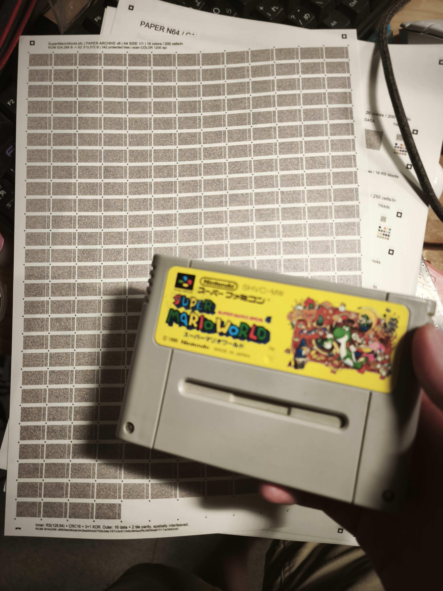
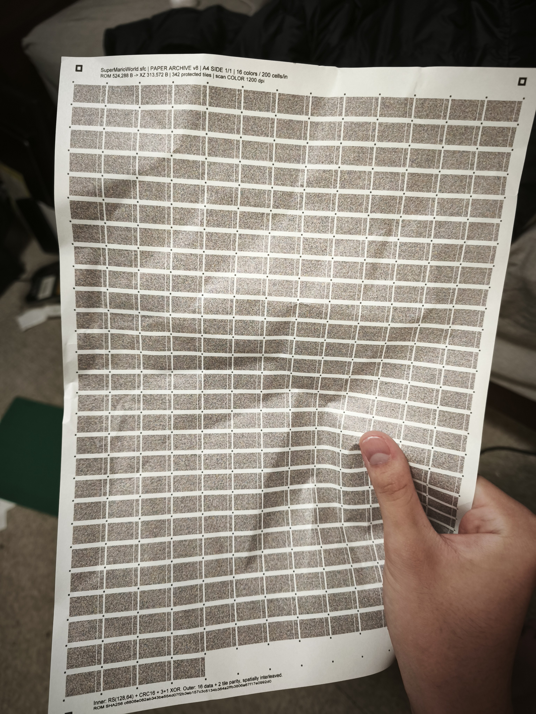

# paper-n64

**データを紙に印刷し、スキャンして元のファイルへ戻す実験。A4片面1枚から512 KiBのファイルを完全復元できました。**

Brother DCP-J1270Nと普通紙を使い、16色・200セル/インチで印刷、1200dpiカラーで読み取っています。通常の紙に加え、揉んで戻した紙と、4つ折りにしてポケットへ入れ5分歩いた紙からも、SuperMarioWorld.sfcの524,288バイトを完全復元しました。いずれも原本とのバイト単位比較とSHA-256が一致しています。

出発点は「Nintendo 64のソフトをA4両面1枚に収めたい」という目標です。**Nintendo 64の対象ROMを1枚に収める目標は未達**です。

## 実物

### スーパーファミコンのカセットと、データを保存したA4用紙



### くしゃくしゃにして戻した紙



写真は実験の様子を示すものです。復号に使ったのはフラットベッドスキャナーの画像で、この写真から復元したわけではありません。公開用写真は画像の画素を変えず、GPS等の撮影情報を除き、表示方向だけを保持しています。

## 確認できたこと

2026-10-24の実機試験。3試験はそれぞれ独立した1回のスキャンから復元しており、別の紙・別のスキャンの回収データを合成していません。

| 用紙の状態 | 単独で回収できた区画 | 最終結果 |
|---|---:|---|
| 通常の印刷紙 | 310 / 342 | 残りの部分データと外側の誤り訂正で完全復元 |
| かなりくしゃくしゃにして戻した紙 | 323 / 342 | 局所ゆがみ補正と外側の誤り訂正で完全復元 |
| 4つ折り、ポケットへ雑に入れて5分歩行後 | 328 / 342 | 残る14区画を外側の誤り訂正で補完し完全復元 |

復号処理を途中で改善しているため、この区画数だけで紙の状態による優劣は比較できません。また各条件1例の結果であり、任意の折り目・破れ・摩耗や長期保存への保証ではありません。

- 元ファイル: **524,288 B（512 KiB）**
- XZ圧縮後: **313,572 B**
- メタデータ込み: **313,856 B**
- v8形式の片面容量: **317,376 B**（ファイル情報と圧縮データを入れる領域）
- 元ファイル・3試験の復元ファイルのSHA-256:

```text
c6808e082ab343be554d07f2b3eb157c3c5134b364a2ffb3806a67f17e0992d0
```

圧縮データと展開後ファイルそれぞれについて、紙自身に保存したSHA-256を検証します。元ROMはこれらの検証が終わった後の追加照合だけに使用し、色の学習や欠損の穴埋めには使いません。

[通常紙の記録](smw-v8-scan-success.md) / [揉みシワの記録](smw-v8-crumpled-success.md) / [4つ折り・ポケット試験の記録](smw-v8-folded-pocket-success.md) / [結果JSON](results/physical-tests.json)

## しくみ

```text
任意のファイル
  → XZ圧縮 + ファイル名・サイズ・SHA-256
  → 外側RS（16データ区画 + 2訂正区画、19組）
  → 内側RS + アドレス + CRC16 + 3データ/1 XOR
  → セル配置シャッフル + 16色マスク
  → 校正パターン・目印と一緒にA4へ印刷
  → 1200dpiカラーでスキャン
  → 位置合わせ・色判定・検証済みデータによる再学習
  → 内側/外側の訂正 → XZ展開 → ハッシュ検証
```

13列×27行の351枠中342区画を使用します。各区画は96×64データセルと16×64の既知校正セルを持ち、目印を隣と共有します。セルのピッチは0.127mm。ドット幅はピッチの約70%です。

内側はRS(128,64)で、各メッセージはアドレス4 B・データ58 B・CRC16からなります。3個のデータブロックにつき1個のXORブロックを加えます。外側は1,044 Bの区画をRS(18,16)で保護し、同じ訂正組が紙面で偏らないよう分散配置します。ソフトウェア試験では、物理的な1行全体・1列全体の区画欠損をそれぞれすべて復旧できることを確認しています。

色判定はQDAと隣接色補正を使用します。既にRS・アドレス・CRCを通ったブロックを追加の色見本として使い、位置と判定器を改善します。揉みシワの試験では、区画全体の移動・伸縮だけで足りなかったため、区画内部の滑らかなゆがみを3次多項式で補正しました。

## 手元のファイルで試す

Python 3.11以降と、Pillow・NumPy・reportlab・reedsoloを使います。印刷・WIAスキャン用のPowerShellはWindows向けです。実機確認済みなのはBrother DCP-J1270Nの組み合わせです。

```sh
python -m pip install -r requirements.txt
python build_smw_v8.py path/to/your-file.bin --output generated
```

圧縮データとファイル情報が317,376 Bを超える場合は1枚には入りません。ファイル名に`smw`が残っていますが、エンコーダーには任意のローカルファイルを指定できます。

`generated/` に1200dpiのPNG、原寸A4の`paper-v8.pdf`、符号化レポートを出力します。圧縮コピーや符号化データもローカルに作成します。これらはGitの追跡対象外です。

### 印刷

A4原寸、カラー、普通紙、最高画質で印刷します。「用紙に合わせる」等の拡大縮小は避けます。片方向印刷も試しましたが、周期的な濃淡の縞が消えたという結果は得られていません。

この実験で用いたWindowsのジョブ設定を作る場合は、Windows PowerShell 5.1で次を実行します。ネイティブのBrotherドライバーが必要です。プリンター全体の既定設定は変更せず、ジョブ用の設定を作成します。

```powershell
.\prepare-best-quality.ps1 -Color
.\prepare-unidirectional.ps1
.\print-probe.ps1 -ImageName generated\smw-v8-print-1200dpi.png -PrinterName 'Brother DCP-J1270N Printer' -DevModeFile best-quality-color-unidirectional.devmode -DocumentTitle 'Paper archive v8'
```

プリンター名は実際の登録名に合わせてください。既存の端末で作ったDEVMODEバイナリは同梱せず、各環境のドライバーから生成します。ドライバーの対応機能が異なる環境での動作は未確認です。

### スキャンと復元

1200dpiカラー、A4全体をBMPまたはPNGで保存します。BrotherのネイティブWIAドライバーでスキャンする例:

```powershell
.\scan-v8.ps1 -ScannerName 'Brother DCP-J1270N LAN' -OutputDirectory scans
```

スキャン画像のファイル名を指定して復号します。

```sh
python bootstrap_smw_v8.py scans/your-scan.bmp
python assemble_smw_v8.py scans/your-scan.bmp
```

出力はスキャン画像と同じ場所の`画像名-enhanced-v8`と`画像名-assembled-v8`です。最後のレポートで`complete: true`、`unknown_data_bytes: 0`を確認します。合格時は`restored-元の名前`を保存します。元のファイルや印刷前のPNGは復号に不要です。

原本との追加比較を行う場合:

```sh
python assemble_smw_v8.py scans/your-scan.bmp --verify path/to/your-file.bin
```

復元が不十分なときは、同じ画像に対して候補数を増やした再判定や局所ゆがみ補正を試せます。

```sh
python recover_smw_v8.py scans/your-scan.bmp --budget 54 143
python decision_smw_v8.py scans/your-scan.bmp 143
python warp_smw_v8.py scans/your-scan.bmp 143
python assemble_smw_v8.py scans/your-scan.bmp
```

`143`は区画番号の例です。局所ゆがみ補正には、その画像から既に確定できたブロックが必要です。画像の中身を変更した場合は別のファイル名で処理し、異なる画像の回収キャッシュを混ぜないでください。

## コードと実験の履歴

| 段階 | 主なファイル | 内容 |
|---|---|---|
| v1〜v3 | `build_probe.py`, `build_bw_probe.py`, `build_color_v3.py`, `decode_*` | 白黒・カラーの密度試験、解像度・印刷品質の比較 |
| v4 | `build_ecc_v4.py`, `decode_ecc_v4.py` | RS・CRC・XOR、白い隙間を持つドット |
| v5 | `build_multicolor_v5.py`, `decode_multicolor_v5.py` | 8/10/12/16/20色の比較、判定器の検証・修正 |
| v6〜v7 | `build_calibration_v6.py`, `build_calibrated_v7.py`, `decode_calibrated_v7.py` | 独立した校正セル、QDA、位置合わせ、周期的濃淡の調査 |
| v8 | `codec_v8.py`, `build_smw_v8.py`, `read_smw_v8.py` | 全面形式、二重の訂正、ファイル全体の保存 |
| v8復号改善 | `bootstrap_smw_v8.py`, `recover_smw_v8.py`, `decision_smw_v8.py`, `warp_smw_v8.py`, `assemble_smw_v8.py` | 検証済み部分データからの再学習、局所変形、バイト単位の外側訂正 |

初期スクリプトと当時のメモは研究履歴として残しています。一部は当時のフォルダー配置・Windowsフォント・別途生成される参照データを前提にしています。最初に動かす入口は上のv8手順です。当時の「現在」「未検証」等の記述は、その段階の状況を表します。

- [先行研究と初期検証](research-findings.md)
- [多色判定器の修正](decoder-improvement-notes.md)
- [v7校正形式](calibrated-v7-protocol.md) / [位置合わせの所見](calibrated-v7-findings.md)
- [縦方向の周期的な濃淡](v7-banding-investigation.md) / [片方向印刷との比較](v7-unidirectional-findings.md)
- [初期のN64容量計算](capacity-budget.md)
- [Optar・HCCB・Bulan/Sharmaの調査と適用](prior-art-optar-hccb-bulan-20261024.md)

## Nintendo 64の目標まで

対象のSuper Mario 64 Shindou Editionは8,388,608 B、実測XZ圧縮後は5,660,452 Bでした。v8の片面容量317,376 Bを単純に両面へ拡張しても634,752 Bで、**必要容量はその約8.9倍**あります。これは両面の実機復元を確認した値ではなく、現在の片面形式からの計算です。

現在の成果はスーパーファミコンの対象ファイルを1枚へ収めた段階です。今後は細かい位置合わせ・色候補の軟判定・色干渉の補正を比較し、実際に復元できる容量で評価します。

## 参考にした公開資料

- [PaperBack / Oleh Yuschuk](https://www.ollydbg.de/Paperbak/): 疎なドット、局所同期、RS/CRC、XOR復旧。
- [Twibright Optar](https://ronja.twibright.com/optar/): 細密な同期格子とサブピクセル位置合わせ。
- [Parikh・Jancke / HCCB, WACV 2008](https://deviparikh.com/publications/ParikhJancke_WACV_2008_barcodes_update.pdf): 局所位置・色の信頼度・復号結果による段階的探索。
- [Bulan・Sharma, TIP 2011](https://hajim.rochester.edu/ece/sites/gsharma/papers/BulanColorBarcodesTIPMay2011.pdf): CMY各層の楕円向き変調と尤度を使う復号。
- [Blasinski・Bulan・Sharma, TIP 2013](https://hajim.rochester.edu/ece/sites/gsharma/papers/HenrykColorMobileBarcodesTIP0413.pdf): 色干渉の物理モデルと推定。
- [HiQ](https://arxiv.org/abs/1704.06447), [JAB Code](https://github.com/jabcode/jabcode): 多色分類・隣接干渉・同期・符号化の参考。

本実装はこれらの方式の忠実な再実装ではありません。参考にした工夫と、今回独自に試した処理を各実験メモで区別しています。依存ライブラリ・参考実装の権利はそれぞれの権利者に帰属します。

## 公開範囲

コード、実験メモ、ペイロードを含まない集計結果、写真を収録しています。商用ゲームのROM本体、圧縮コピー、復元可能な高解像度印刷データ・スキャン画像、回収済みペイロードやブロックキャッシュは同梱していません。手元のファイルから生成して試してください。

## ソフトウェア検証

```sh
python -m unittest discover -s tests -v
```

符号の訂正・行列欠損・ハッシュ検証・コード配置に依存しないキャッシュ読込みを確認します。印刷前PNGのソフトウェア往復試験と、紙を通した実機試験は別の結果として記録します。

公開準備時は、非公開の`vendor/`を含まないコピーとPyPIのreedsolo 1.7.0で4テストが合格しました。また、316,000 Bの擬似乱数ファイルを印刷前PNGへ符号化し、別フォルダーにある画像から342/342区画を回収、元ファイルとの完全一致を確認しました。[検証結果](results/software-publication-check.json)

確認環境: Python 3.12.14、NumPy 2.3.5、Pillow 12.3.0、reportlab 4.4.9。依存パッケージの許容範囲すべてで動作を確認したわけではありません。
